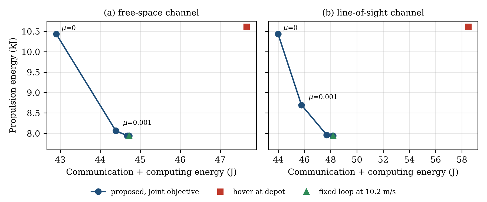
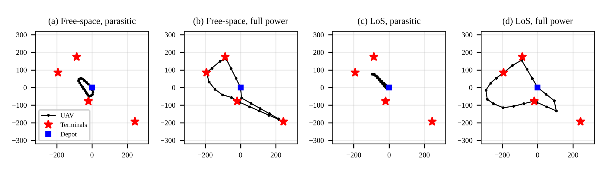
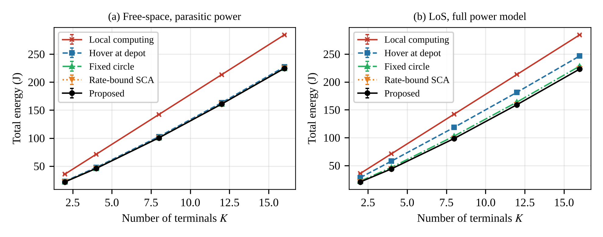
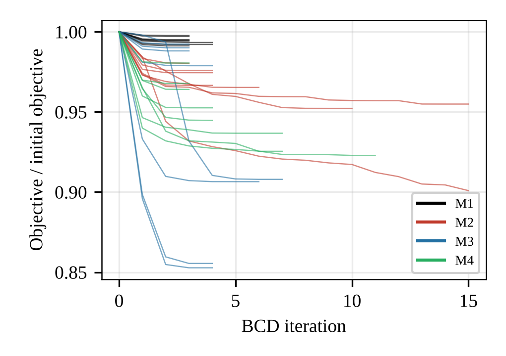

# Deadline-constrained energy minimization via joint UAV trajectory and offloading design in UAV-aided MEC

Simulation code and raw results for the manuscript of the same title (author: Akash B, Rajalakshmi Engineering College).


## Key results

**Energy versus propulsion energy (weighted objective, Section 5.11 of the paper).** A small weight on propulsion energy cuts it by about 22% for 3.5% more communication and computing energy (free-space channel).



**Example trajectories for the four model combinations.**



**Total energy versus number of terminals.**



**Convergence of the BCD algorithm.**



## Contents
- `sim.py` - system models (free-space and line-of-sight channels; drag-only and complete rotary-wing power), the proposed BCD algorithm, the rate-bound SCA baseline, and the local, hover and fixed-circle baselines.
- `exp.py` - experiment runner (multiprocessing).
- `pos.py` - terminal-position-error study.
- `analyze.py` - statistics (paired savings, 95% intervals), figures and tables.
- `suite_*.json` - experiment definitions. `res_*.json` - raw results. `figures/` - figures of the paper (this folder is not in the repository yet; add the figures or delete this mention).

- `ext_run.py`, `analyze_ext.py` - the two extensions: propulsion energy in the objective (weight `mu`, `sim.run_joint`) and unequal task sizes (`Prm.L` may be an array). Results: `res_joint.json`, `res_het.json`, `summary_ext.json`, `fig_pareto.png`.

## Reproduce
```
pip install -r requirements.txt
python3 exp.py suite_default.json res_default.json 200 2
python3 analyze.py
```
Arguments of `exp.py`: suite file, output file, number of placements, number of processes. Placements use seed 2026.

Extensions (about 8 min and 15 min on 2 cores):
```
python3 ext_run.py joint 40      # writes res_joint.json
python3 ext_run.py het 60        # writes res_het.json (task sizes: seed 777 + placement index)
python3 analyze_ext.py het       # writes summary_ext.json and fig_pareto.png
```
`sim.py` is backward compatible: with `mu = 0` and scalar `L` it reproduces the original results exactly.

## Notes
- The rate-bound SCA baseline is our re-implementation of the technique used in Wu, Zeng and Zhang (IEEE TWC, 2018), not the original authors' code.
- Text and code were drafted with the help of an AI assistant (Claude, Anthropic), as declared in the manuscript.

## Citation
Please cite the manuscript (details to be added after publication). Archive DOI: add the Zenodo DOI here.

## Licence
MIT, see `LICENSE`.
